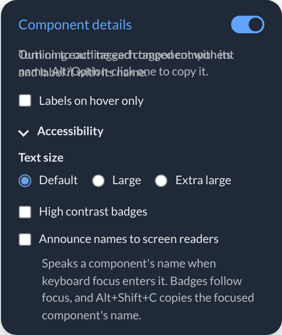

# component-details-overlay

A small React overlay for development. Flip a switch and every tagged component on the page gets an outline and a badge with its name. Off, it changes nothing. On, it draws on a separate layer that ignores the mouse, so clicks, scrolling and layout work as before.

Want the Angular version? It lives at [ngx-component-details-overlay](https://github.com/bchalker/ngx-component-details-overlay).

## Why

Every piece of the screen has a name in the code. Use that name in Slack, a ticket or a review and the developer knows exactly what you mean. No screenshot, no back and forth.

It also lets product owners, QA testers and designers talk to developers clearly, and shows them a bit of how the screen is built.

| Vague | Clear |
| --- | --- |
| "The pill in that table looks off on mobile." | "`Table › StatusBadge` is cut off at 320px on /customers." |

## How to use it

1. Switch on Component details in the bottom-right corner.
2. Find the badge on the thing you mean. The badge is its name.
3. Alt-click it (Option-click on Mac) to copy the name and paste it into your message. If it sits inside another component, add that first, like `Card › Button`.

No badge on something? It is untagged, so say that: "the banner on /customers is untagged."

## Accessibility

The toggle card has a collapsed Accessibility section with text size, high contrast badges and screen reader announcements.



More in the [reference](docs/reference.md#accessibility).

## Set it up

The quickest way is to paste this into Claude Code, Cursor, Copilot, Windsurf or Codex, from inside your project:

```text
Add component-details-overlay to this project. Install it with npm (if npm can't find it, use github:bchalker/component-details-overlay), then read node_modules/component-details-overlay/AI-SETUP.md and follow it.
```

It installs the package, adds the provider and toggle, and tags your shared components. [AI-SETUP.md](AI-SETUP.md) is the file it follows.

By hand:

```bash
npm install component-details-overlay
# not on npm yet: npm install github:bchalker/component-details-overlay
```

```tsx
import {
  ComponentDetailsProvider,
  ComponentDetailsToggle,
  tag,
} from 'component-details-overlay';
import 'component-details-overlay/styles.css';

export function Root() {
  return (
    <ComponentDetailsProvider>
      <App />
      <ComponentDetailsToggle position="bottom-right" />
    </ComponentDetailsProvider>
  );
}

export function Card({ title, children }) {
  return (
    <section {...tag('Card')} className="card">
      <h2>{title}</h2>
      {children}
    </section>
  );
}
```

Spread `tag()` onto the outermost element of each component. A badge only shows on tagged components, and `tag()` writes nothing in production builds. React 17 or later is required, and I've only tested React 19.

Next.js App Router: the provider is a client component, so put it in a small file that starts with `'use client'`. In a Server Component, import `tag` from `component-details-overlay/tag`.

## More

- [Reference](docs/reference.md): name modes, configuration, theming, contrast, font, how it works, limitations
- [SETUP.md](SETUP.md): setup walkthrough
- [docs/audit-workflow.md](docs/audit-workflow.md): using it to audit a page against a design

## License

MIT
